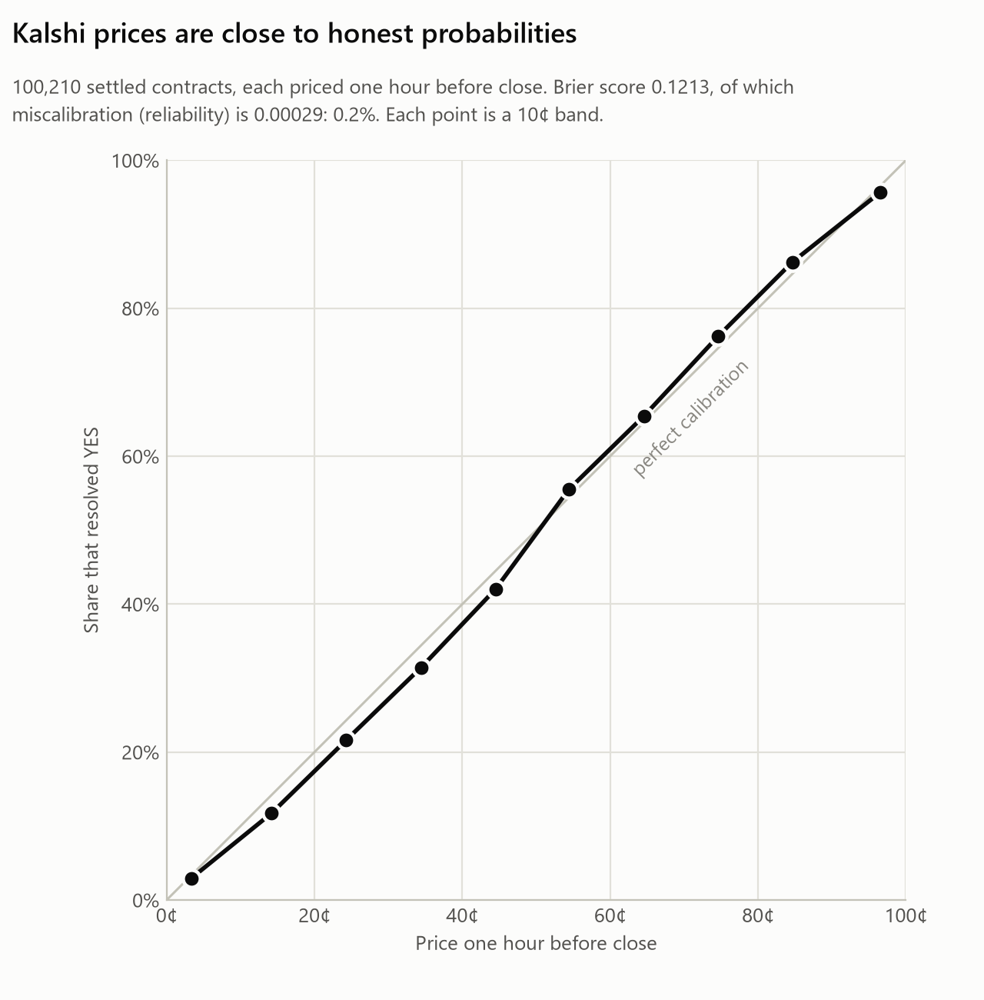

# Kalshi calibration study

This repository is a study of whether prices on Kalshi, a US prediction market, behave like honest probabilities. A Kalshi contract pays $1 if its event happens and nothing if it does not, so a contract trading at 30 cents is the market saying the event has a 30% chance. The study checks that claim on about 100,000 settled contracts and looks in particular for the favourite-longshot bias, the pattern first seen at racetracks where people overpay for long shots and underpay for favourites.

The repository also holds the research that grew out of the study and the code of a trading bot built to test one of its findings in practice. The bot ran on paper and, for about five weeks in the autumn of 2026, with a small amount of real money. It has been shut down. Its server is gone and its API keys are revoked.

The full write-up of the main study is [reports/calibration-study.md](reports/calibration-study.md).



## What the study found

The main study uses 100,210 settled binary contracts from 29,895 events that closed between December 2025 and June 2026. Each contract is priced at its last trade one hour before close, because the price at settlement already equals the answer in 92.5% of markets and so says nothing about the forecast.

Kalshi's prices turn out to be close to honest probabilities. The Brier score is 0.121, and almost all of it comes from the uncertainty of the questions themselves rather than from prices being off. On top of that there is a small favourite-longshot bias with the expected shape. Every price band under 50 cents won less often than its price implied, and four of the five bands above 50 cents won slightly more often. The largest gap is about 3 cents, in the 30 to 40 cent band. The bias holds up after correcting for testing ten price bands at once and for the fact that contracts in the same event move together. A logistic fit with no price bands at all gives the same answer.

The bias is strongest in markets that were open for less than a day. It looks larger outside sports, but there are too few non-sports events to say so with any confidence. Priced six hours before close instead of one, the bias is too faint to measure.

A trading rule was estimated on the first 60% of the data and tested once on the remaining 40%, with Kalshi's fee and half-Kelly bet sizes. The edge left after fees was under one cent per contract. That is smaller than a realistic bid-ask spread, which the historical data cannot measure, so the study does not show that the bias can be traded at a profit.

A replication on 85,805 fifteen-minute crypto, metals and energy markets from July to October 2026 found the same shape. Favourites priced at 90 cents or more won 95.8% of the time against 94.4% implied by their prices. Once each order was charged the price that real orders actually paid, the growth-optimal Kelly bet fell below zero, and the edge per bet changed sign partway through the period.

## Repository layout

- `kalshi_calibration/` is the study's Python package: downloading from Kalshi's public API, cleaning, the calibration statistics, segmentation, the backtest, the 15-minute replication and the figures.
- `tests/` holds unit, property-based and end-to-end tests for the package and the findings dashboard.
- `dashboard/` is a small one-page view of the study's key results.
- `docs/` covers the method, the findings, the limitations, the data sources, a working journal and the design decisions behind each step (`docs/adr/`).
- `reports/` holds the paper, its tables and figures, and the reports written during the follow-up research.
- `notebooks/` holds an early exploration of the Kalshi API and two notebooks that display the study's results.
- `research/` holds the follow-up studies.
- `bot/` holds the trading bot and its own dashboard.
- `config.yaml` holds every setting and threshold the study uses, each with the reason for its value.

### The research folder

Each follow-up study has its own folder with a README that states the question, how to run it and what it found. The largest is `research/kalshi_15min/`, the backtests of the favourites rule on Kalshi's fifteen-minute markets that the bot was built from. The others test variations and neighbouring ideas: the price at a market's first trade, whether the bias faded in recent weeks, selling early, the last minute before settlement, resting orders at the bid, thin markets, weather markets and Polymarket's five-minute markets. Several of them failed their pre-registered tests, and their READMEs say so. Raw data is not committed; each README says how to download or rebuild it. [research/README.md](research/README.md) has the full index.

### The bot

The bot bought the likely side of Kalshi's fifteen-minute crypto, metals and energy markets when it was priced between 92 and 99.9 cents, sized each bet as a small share of the account and held it to settlement. It runs as a dry run by default, which watches real prices and records what it would have bought without sending any orders; live trading needs your own Kalshi API key in a `.env` file. The code is the `bot/kalshi_bot/` package: the trading loop, the Kalshi API client, the SQLite ledger, the halts that stop it when something looks wrong, and a local web dashboard under `web/`. Its tests are in `bot/tests/`, and `bot/deploy/` has example service files for running it on a Linux server. [bot/README.md](bot/README.md) explains how to set it up and run it.

## Running the study

The study needs Python 3.11 or later. Install the dependencies from the repository root:

```bash
pip install -r requirements.txt
```

Installing the package with `pip install -e ".[dev]"` works too and gives the same set.

The results are already committed, so you can look at them without downloading anything. `make figures` redraws the figures from `reports/summary.json` and `reports/replication.json`, and `make dashboard` serves the findings page at http://localhost:8080 (pass `--port` to `python dashboard/server.py` to use another port).

To rebuild everything from Kalshi's public API, run the steps in order. No account or key is needed. The two downloads take hours and can be stopped and restarted, since a rerun picks up where the last one stopped.

```bash
make ingest          # settled markets of the pinned series -> data/raw/
make ingest-trades   # each market's last trade before close -> data/raw_trades/
make clean           # raw -> interim -> processed tables
make analyze         # tables, tests and backtest -> reports/*.csv and reports/summary.json
make replicate-data  # every 15-minute market, minute by minute -> data/replication/
make replicate       # the 15-minute replication -> reports/replication.json
make figures         # reports/figures/
```

Each target is a thin wrapper around a module, so the same steps run without `make`, for example `python -m kalshi_calibration.ingest.kalshi` or `python -m kalshi_calibration.analysis.report`. The Makefile lists them all. The analysis is deterministic: the same processed table and `config.yaml` give the same numbers, bootstrap included.

## Tests

```bash
make test-study      # or: python -m pytest -q tests
```

This runs about 700 tests of the package and the findings dashboard, including property-based tests that check rules on many generated inputs and an end-to-end run of the whole pipeline against a fake Kalshi server. None of them touch the network. Setting `HYPOTHESIS_PROFILE=thorough` makes the property-based tests try ten times as many cases. `make test` also runs the bot's and the 15-minute research's suites, and `make coverage` reports line and branch coverage across all three.

## Limitations

The most important limitation is that the historical data has no usable order book, so the backtest fills every trade at the last traded price and cannot charge the bid-ask spread. The edge it reports is smaller than a plausible spread, which is why the study stops short of calling the bias tradeable. The data is also 95.9% sports, comes from one venue and covers six months, with about seven weeks held out for the backtest. Heavy favourites priced at 90 cents or more run the wrong way in the main study, and almost all of that comes from one tier of professional tennis for reasons the study does not explain.

[docs/limitations.md](docs/limitations.md) goes through each limitation and what evidence would change it. Nothing in this repository is investment advice.

## License

MIT. See [LICENSE](LICENSE).
